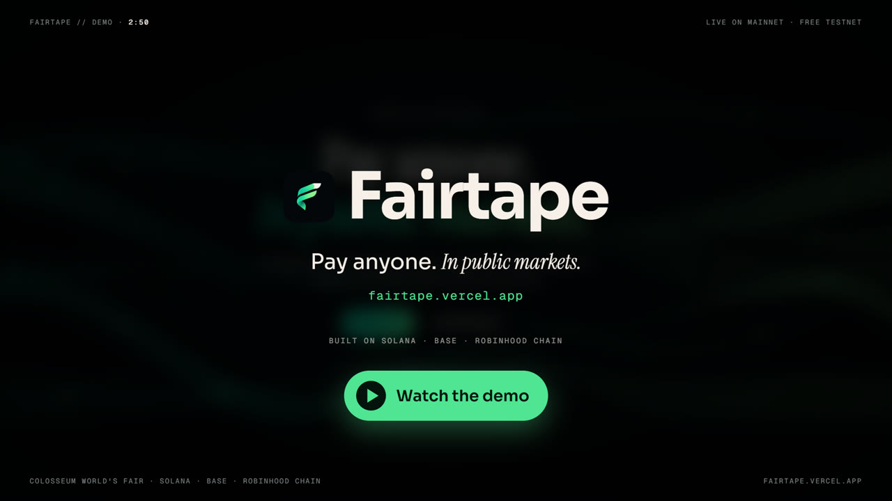

# Fairtape

**Pay anyone. In public markets.**

The same NVIDIA share now trades onchain as four different tokens on three chains, and no two cost the same. Fairtape shows what one real share costs on every chain, takes you to the best price, and lets people pay you exact USDC with the stocks they already hold. Every payment is checked onchain, and Fairtape never holds anyone's money.

[**Live app: fairtape.vercel.app**](https://fairtape.vercel.app) · [**Demo video (2:50)**](https://youtu.be/hONXyhN-Mf0) · [**Pitch video (1:53)**](https://youtu.be/cdnkJZNwu1E) · [Desk contract](https://explorer.testnet.chain.robinhood.com/address/0x0eb46917ee67622308a3748dc01a373d2e23108d) · [Proof it works](#proof-it-works)

[](https://youtu.be/hONXyhN-Mf0)

*Every screen in the demo is the live app, reading mainnet and the testnets in real time.*

Built solo by Uzoechi Raphael in Enugu, Nigeria, for Colosseum's **Crypto World's Fair** (Solana, Base and Robinhood Chain tracks).

## At a glance

| | |
| - | - |
| **The problem** | NVIDIA trades as NVDAx and NVDAon on Solana, NVDA on Robinhood Chain and NVDAc on Base. Four prices, and each issuer handles dividends its own way, so raw prices can't be compared. |
| **The tape** | 12 stocks across 45 venues and 4 issuers on 3 chains, every price shown for one real share and checked against Chainlink and Robinhood's market data |
| **Best print** | Start with what you hold on any chain. Fairtape asks for a real route to every issuer and ranks them by how many real shares you end up with |
| **Pay links** | Ask for exact USDC on Base or Solana. The payer can use any stock, stablecoin or gas token on any of the three chains. The link turns Paid only after our server reads the settlement onchain |
| **Free testnet mode** | Every flow runs for real on public testnets with free tokens, always at the live market price. Prices are signed by our server and enforced by the Fairtape desk contract |
| **History** | A GitHub Action records the whole tape every 5 minutes, building a dataset of the price gaps between issuers |
| **Custody** | None. Users sign every transaction in their own wallet, and funds go straight to the merchant |
| **Tests** | 17 checks on the desk contract (pricing, exact amounts, refunds, signatures, replay, slippage, inventory, ownership) |

## Contents

- [The idea in one minute](#the-idea-in-one-minute)
- [Why "per share" matters](#why-per-share-matters)
- [Proof it works](#proof-it-works)
- [How each chain is used](#how-each-chain-is-used)
- [Where the numbers come from](#where-the-numbers-come-from)
- [Try every flow for free](#try-every-flow-for-free)
- [Safety](#safety)
- [Running it yourself](#running-it-yourself)
- [Repository layout](#repository-layout)
- [Business](#business)
- [What Fairtape doesn't do](#what-fairtape-doesnt-do)

## The idea in one minute

Stocks finally came onchain in 2026, but they arrived in pieces. xStocks and Ondo issue them on Solana, Robinhood issues its own on Robinhood Chain, and Coinbase issues its own on Base. If you ask "what does one NVIDIA share cost onchain right now?", nobody can tell you, and you can't easily spend any of them.

Fairtape does three things:

1. **The tape.** Every issuer of the same stock on one screen, priced per real share, with how far each one sits above or below the actual share price, and which one is cheapest to buy or best to sell right now.
2. **Best print.** Start from whatever you hold, on any chain. Fairtape asks for a real, executable route to every venue, ranks them by how many shares (or dollars) you actually end up with after fees and bridges, and you sign once.
3. **Pay links.** A freelancer asks for an exact amount of USDC. Their client pays with the stocks they hold, on whichever chain they're on. The freelancer gets exact dollars, and the link only says Paid once the server has seen it onchain.

All the mainnet data is live. Nothing is mocked.

## Why "per share" matters

Issuers pay out dividends by quietly changing how many shares one token stands for. Each does it differently:

* **xStocks and Ondo (Solana)** use the Token-2022 scaled UI amount. The new multiplier kicks in at a set time, and we read it from Jupiter's price API or the mint account.
* **Robinhood (Robinhood Chain)** uses ERC-8056 `uiMultiplier()` on the token contract.
* **Coinbase (Base)** uses the B20 `uiMultiplier()` on the token contract.

On October 1, one SPYx token was worth 1.0057 shares. If you compared raw token prices, you were already off by 57 basis points, which is more than the price gap you'd be trying to catch. So before comparing anything, Fairtape divides every token price by that issuer's live multiplier.

## Proof it works

Real signed transactions, each confirmed onchain by the server. The testnet fills all happened at the live price of the real stock.

| What happened | Proof |
| - | - |
| **Bought a stock at the real price.** 1 test USDC bought 0.002612 test TSLA at $382.81, Tesla's live market price at that moment | [Robinhood Chain Testnet tx 0xdd18…8c21](https://explorer.testnet.chain.robinhood.com/tx/0xdd18ef9a7cd819abf5a49d9e9ca15e82d8f66beb9266a5cfa2f5072c0da48c21) |
| **Paid a link with a stock.** A 1 USDC link was paid with 0.002612 test TSLA. One signature sold the stock at the live price and sent exactly 1 USDC to the merchant | [Pay link](https://fairtape.vercel.app/pay/i2nh2x79zg) · [tx 0x19e3…37d1](https://explorer.testnet.chain.robinhood.com/tx/0x19e3a837099fd2faaf2aa92f39b1991eed93494a8dc51aef47c9a43fa30a37d1) |
| **Paid a link with ETH.** 0.0004 test ETH at $2,501.69 settled another 1 USDC link | [Pay link](https://fairtape.vercel.app/pay/8cde8zassi) |
| **Paid across chains.** 1 USDC sent from Base Sepolia landed in a Phantom wallet on Solana Devnet through Circle CCTP | [Pay link](https://fairtape.vercel.app/pay/yig4pkzww6) · [Base Sepolia tx](https://sepolia.basescan.org/tx/0xd89de100c0634f1bb746c640d0ca63aca72cc0cb8ff1b02f50faef419586f01f) · [Solana Devnet tx](https://explorer.solana.com/tx/w1nBNPtXhsscT58SyTA9uMobdafmBe9zEdMy4o9NYWtqALdg4R6ycekV6cnJHYrwdCDpWJToHyLsRNBPin9AxTT?cluster=devnet) |
| **Mainnet best print.** $100 of USDC on Base, compared across all four NVIDIA issuers: the best route gave 0.4360 shares and beat the worst by $0.42 (live quotes, shown in the demo) | [Try it](https://fairtape.vercel.app/trade) |

**Contracts**

| Contract | Address |
| - | - |
| **FairtapeDesk** (fills testnet trades and stock payments at server-signed real prices) | [`0x0eb46917ee67622308a3748dc01a373d2e23108d`](https://explorer.testnet.chain.robinhood.com/address/0x0eb46917ee67622308a3748dc01a373d2e23108d) on Robinhood Chain Testnet (46630) |

## How each chain is used

| Chain | What Fairtape does there |
| - | - |
| **Solana** | xStocks and Ondo stocks priced through Jupiter, multiplier included. Phantom and any Wallet Standard wallet. USDC pay links, and USDC delivery on Solana through Circle. |
| **Base** | Coinbase's stock tokens priced from Aerodrome and Uniswap and checked against Chainlink. USDC pay links, the Base Account and injected wallets, and the Base side of every cross-chain payment. |
| **Robinhood Chain** | Robinhood's stock tokens priced from Uniswap and Ramses USDG pools and checked against Chainlink, with the oracle pause respected. The Fairtape desk that fills every testnet trade and stock payment at the live market price. |

## Where the numbers come from

* **Robinhood Chain:** stock prices come from the deepest USDG pool (Uniswap v3 or Ramses) and depth from the pool's balances. Each one is checked against its Chainlink feed, and we respect the oracle pause during corporate actions.
* **Base:** Coinbase stock prices come from the deepest Aerodrome or Uniswap v3 USDC pool, checked against Chainlink's Coinbase feeds.
* **Solana:** xStocks and Ondo prices and liquidity come from Jupiter, multiplier included.
* **The real share price:** Robinhood's public market data, which also tells us when trading is halted.
* **Trading:** routes come from LI.FI, which pulls in Jupiter, 1inch, Kyberswap, Across, Relay, Circle CCTP and Mayan. You sign every transaction in your own wallet.
* **The token list:** `scripts/build-registry.mjs` finds each venue from the issuers' and oracles' own lists, then checks every address onchain before the app uses it. That matters: there's a fake "NVDAx" on Solana, and it never makes it in.

## Try every flow for free

The tape always shows real mainnet prices. Every transaction can also run on public testnets with free faucet tokens at [`/test`](https://fairtape.vercel.app/test). Each one is a real signed transaction with an explorer link.

* **Trading** runs on Robinhood Chain Testnet with Robinhood's own test stocks (TSLA, AMZN, AMD, PLTR, NFLX), always at the live price of the real stock.
* **Paying with a stock** also runs on Robinhood Chain Testnet. The desk sells the payer's test stock at the live market price and sends exactly the requested test USDC straight to the merchant.
* **Paying with USDC** works on Base Sepolia, Solana Devnet and Robinhood Chain Testnet, and the server confirms each payment from the chain.
* **Paying across chains** goes from Base Sepolia to Solana Devnet with Circle CCTP. The payer signs once, Circle delivers on Solana (and opens the merchant's USDC account if needed), and the link is only marked paid once we see the USDC arrive.

The tokens are free, but every price on testnet is the real market price. If no live price is available, the desk stops quoting instead of guessing. It only fills what it holds, so testnet trades are small.

A few honest limits on testnet: you can't bridge out of Robinhood Chain Testnet, LI.FI doesn't cover these testnets, and xStocks and Coinbase stocks only exist on mainnet. So test stock payments settle on Robinhood Chain Testnet, and the cross-chain demo moves USDC from Base Sepolia to Solana Devnet.

## Safety

**The desk contract** ([`contracts/FairtapeDesk.sol`](contracts/FairtapeDesk.sol)) only fills at a price our server read from mainnet sources and signed seconds earlier:

* The signature covers the desk address, the chain id, both tokens, both prices and an expiry, so a quote can't be changed, reused after it expires, or replayed on another desk or chain.
* Malleable signatures are rejected, and only the configured price signer is accepted.
* The payer sets a minimum (or maximum) amount, so a fill can't land worse than the quote.
* Exact-output fills round in the desk's favour and refund any extra ETH. It checks inventory before pulling funds, and it is guarded against reentrancy.
* Only the owner can withdraw inventory or change the signer.

**Pay links** never hold funds. The payer's wallet sends USDC straight to the merchant's address, and the server marks a link paid only after reading the settlement transaction itself.

**The token list** only contains addresses verified onchain from the issuers' and oracles' own lists.

## Running it yourself

```bash
npm install
npm run dev
```

You don't need any keys. These settings are optional:

* `DATABASE_URL`: a Postgres database for production. Without it, the app uses a small embedded database in `.data/`.
* `SOLANA_RPC`, `NEXT_PUBLIC_SOLANA_RPC`, `ROBINHOOD_RPC`, `BASE_RPC`: your own RPC endpoints, since the public ones are rate limited.
* `LIFI_API_KEY`, `LIFI_INTEGRATOR`, `LIFI_FEE`: higher LI.FI limits, plus the small routing fee that is the business model.
* `JUPITER_API_KEY`: Jupiter's paid price API.
* `CRON_SECRET`: protects the snapshot endpoint, which a GitHub Action calls every five minutes to record price history.
* `DESK_SIGNER_KEY` and `NEXT_PUBLIC_DESK_ADDRESS`: the key that signs testnet desk prices, and the desk's address. Deploy the desk with `node scripts/deploy-desk.mjs <owner address>`.

To rebuild the verified token list, run `node scripts/build-registry.mjs`.

**Desk tests** run on an in-memory chain:

```bash
cd contracts/test
npm i solc@0.8.26 ganache@7 viem
node compile.cjs
node FairtapeDesk.test.mjs
```

## Repository layout

```
app/                     Next.js 16 App Router
  tape                   the live tape
  s/[ticker]             one stock across every venue, with its history chart
  trade                  best print: buy, sell or switch issuer
  pay, pay/new, pay/[id] pay links, verified onchain
  portfolio              your holdings on all three chains, in real shares
  test, test/trade       the free testnet versions of every flow
  api/                   the server routes behind all of the above
lib/server/
  tape.ts                reads every venue and puts them on one per-share scale
  routes.ts, lifi.ts     finds and ranks routes
  invoices.ts            pay links, and the onchain check that marks them paid
  desk.ts                real prices for testnet, signed quotes for the desk
  cctp.ts                Base Sepolia to Solana Devnet USDC through Circle
  snapshots.ts, db.ts    price history (Postgres in production, PGlite locally)
  balances.ts            wallet balances on Solana, Base and Robinhood Chain
contracts/
  FairtapeDesk.sol       the testnet desk, plus its tests in test/
scripts/                 token registry builder and desk deploy script
components/              wallets, the transaction runner and the UI
.github/workflows/       records the tape every 5 minutes
```

## Business

* **Revenue:** a routing fee of 10 to 30 basis points on trades (switched off during the beta), a merchant API for platforms that pay people in USDC, and the price gap history between issuers, which we record every few minutes and nobody else is collecting.
* **Go to market:** freelancers and small businesses in emerging markets, starting in Nigeria, who already get paid in USDC and want exposure to US stocks. A pay link is the wedge: the merchant gets exact dollars, the client pays with whatever they hold, and every payment brings a new person to the tape.

## What Fairtape doesn't do

* It doesn't mint, redeem or wrap stock tokens. Each issuer's token is its own legal claim, so only dollars (USDC or USDG) ever move between chains.
* Tokenized stocks aren't available to US persons, or in a few other countries, under the issuers' terms. Fairtape is software that never holds your funds. It isn't a broker.
* A route is only as good as the liquidity behind it. Thin venues, like most Ondo pools today, still show up on the tape, but they're never picked as the best price.

Built during the Crypto World's Fair, starting October 1, 2026. No code existed before the hackathon.
